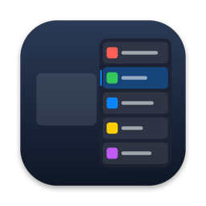
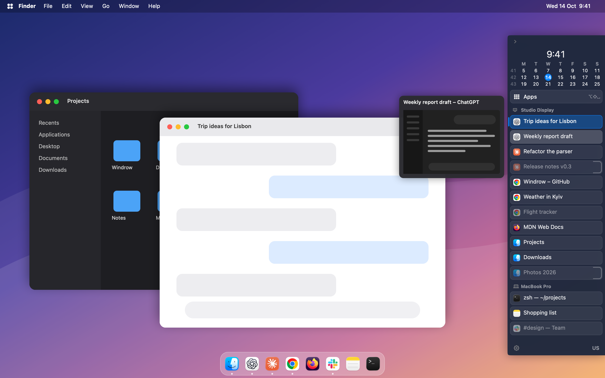
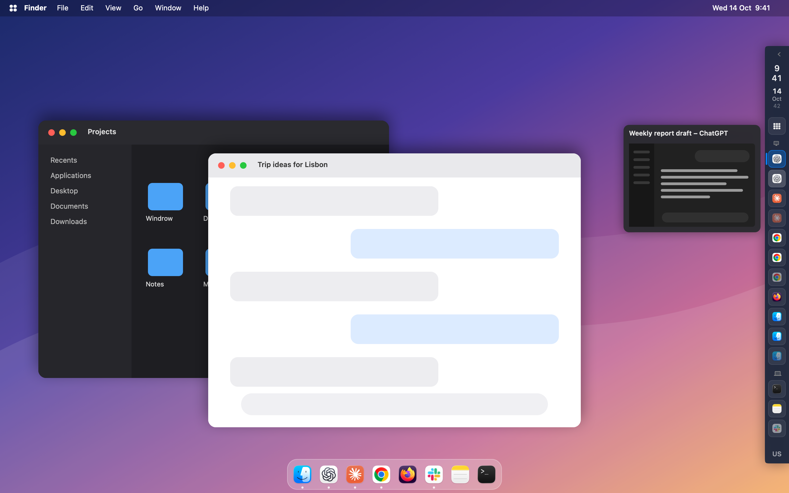
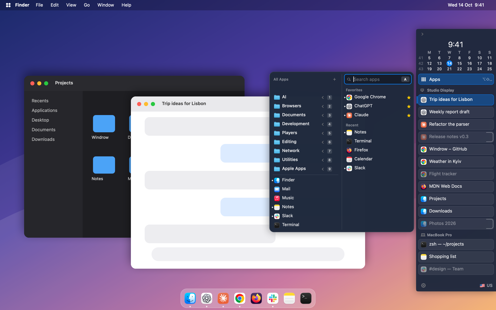
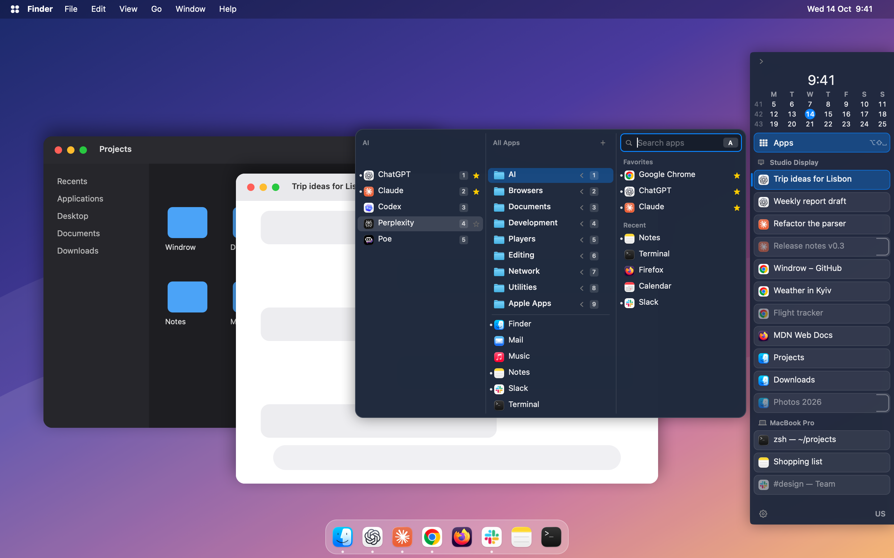
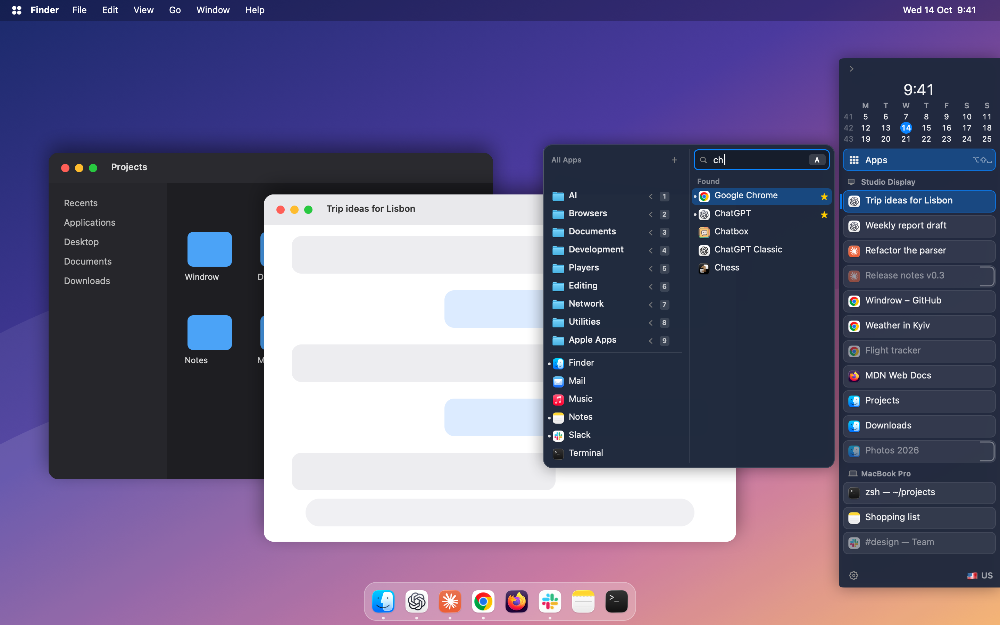
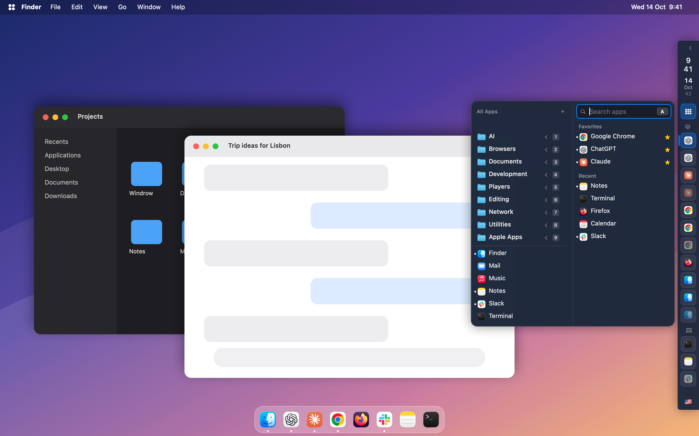
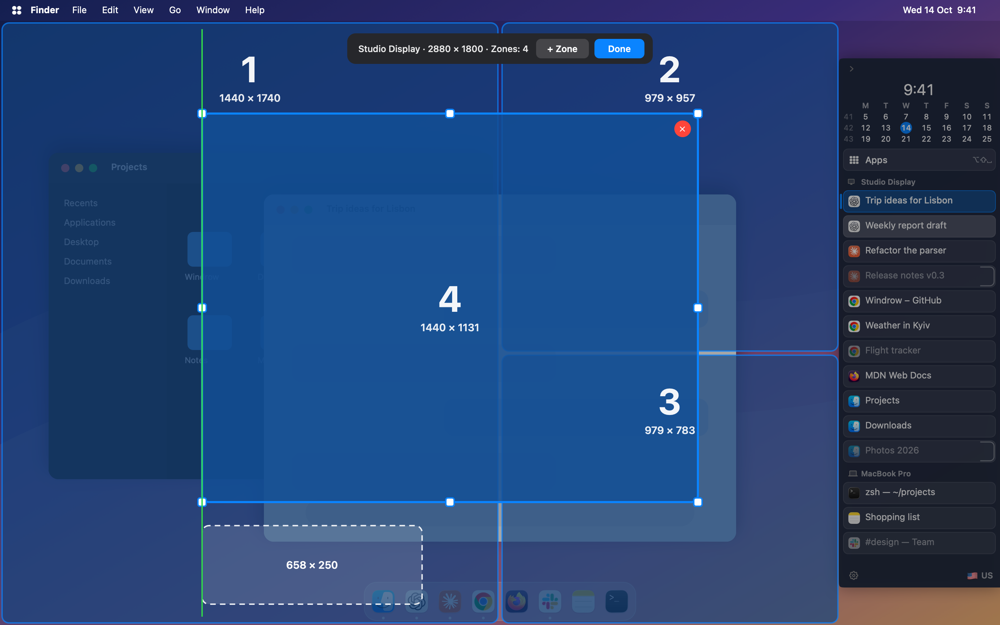
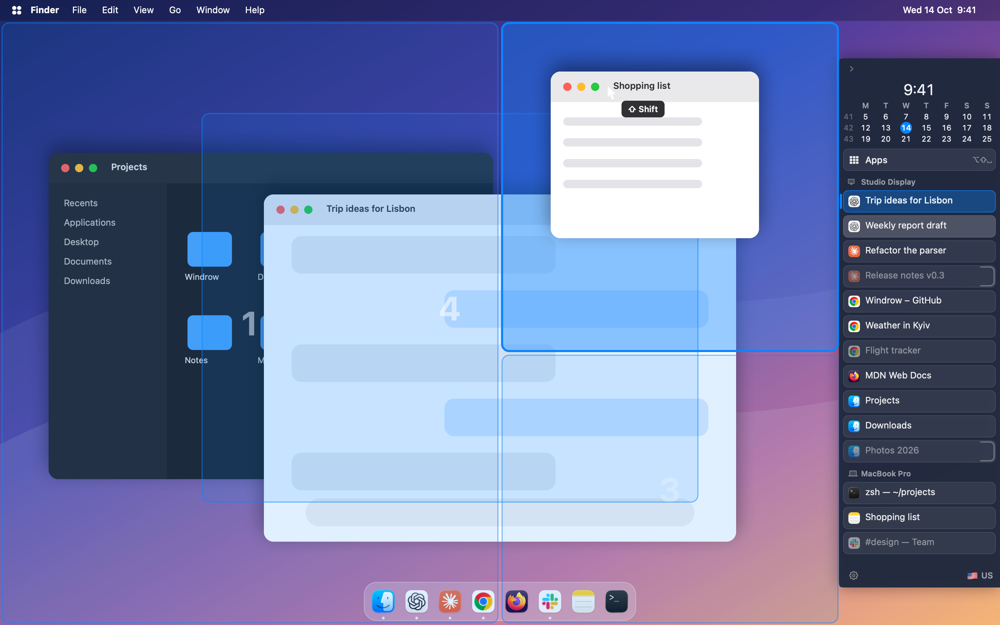

<h1 align="center">Windrow</h1>

Vertical window list for Mac

<b><a href="https://github.com/simplaerai-sv/windrow-app/releases/latest">Download the latest version (.dmg)</a></b>

Windrow is a slim panel at the side of the screen that lists **every open window as its own row** — icon and title — like the vertical taskbar of Windows. Click a row to switch to that window.

<em>Folded to a strip of icons, with a thumbnail on hover.</em>

<em>The app launcher: favorites, recent apps and all apps in your own folders.</em>

<em>Point at a folder to open it; star any app to keep it in Favorites.</em>

<em>Type to search, in any keyboard layout.</em>

<em>It opens from the folded strip too.</em>

<em>Draw your own window zones for each display.</em>

<em>Drag a window with Shift held and drop it on a zone: it takes the zone's place and size.</em>

## Why I made it

I work with a lot of windows — many of them, all day long. The way standard macOS organises them only adds to the chaos: the Dock shows one button per app, and finding the right window means guessing through thumbnails. macOS presents itself as a system for productive work, but this approach makes working at the computer neither more productive nor calmer.

My goal is to bring calm and focus back to work. So I built this panel, and I use it every day.

## Features

- Every window of every display, grouped by display; Finder, Terminal and TextEdit tabs as separate rows.
- Click to switch, click the active row to minimize; a Dock-like right-click menu that can also center a lost window, bring it from another desktop or put it into a zone.
- Fold the panel to a strip of icons; optional auto-hide on hover.
- Drag rows to arrange apps and windows your way; the order is remembered.
- Window thumbnails on hover.
- Clock with a three-week calendar and the current keyboard layout, with its flag, on the panel.
- App launcher: the Apps button or Shift+Option+Space — search, favorites, recent apps and your own folders, which an AI can arrange for you.
- Window zones: draw zones for each display, then drag a window with Shift to snap it into one.
- Themes, background and accent colours, compact or larger rows.
- Experimental: windows from other desktops, with a click switching to that desktop.
- 11 languages: English, Українська, Español, Deutsch, Français, Português (Brasil), Italiano, 日本語, 简体中文, 한국어, Polski.

## Requirements

macOS 15 Sequoia or later, Apple Silicon or Intel.

## Install

1. Download the latest `.dmg` from [Releases](../../releases): `Windrow-…-universal.dmg` works on every Mac.
2. Open it and drag **Windrow** into **Applications**.
3. Open Windrow. Windrow is not yet notarized by Apple, so macOS will say it cannot verify the developer. Open **System Settings → Privacy & Security**, scroll down and click **Open Anyway** next to Windrow.
4. Allow **Accessibility** when Windrow asks — it is needed to see windows and switch between them.
5. Optional: allow **Screen Recording** for thumbnail pictures. Without it thumbnails show only the title.

**About “Source code” on the release page.** GitHub adds “Source code (zip)” and “Source code (tar.gz)” to every release automatically. They contain only this README and the pictures, not the app's code. Windrow itself is the `.dmg` file.

## Privacy

Windrow collects and sends no data about you. Its only connection is a check for a new version on GitHub, about once a day; you can turn it off in Settings → General. Window titles never leave your Mac.

---

### Українською

**Завантажити:** [остання версія (.dmg)](https://github.com/simplaerai-sv/windrow-app/releases/latest)

**Навіщо.** Я постійно працюю з дуже великою кількістю вікон. Те, як їх організовано в стандартній macOS, лише додає хаосу. macOS позиціонує себе як систему для продуктивної роботи, але такий підхід не робить роботу за комп'ютером ні продуктивнішою, ні зручнішою, ні спокійнішою. Моя мета — повернути в роботу спокій і фокус. Тому я зробив цю панель і користуюся нею щодня.

Windrow — бічна панель, де кожне відкрите вікно стоїть окремим рядком з іконкою й назвою; клік переводить у вікно. Кнопка «Програми» під годинником або Shift+Option+Пробіл відкриває запуск програм: пошук, обрані, недавні й власні папки. Зони вікон: намалюйте зони для кожного монітора й тягніть вікно із Shift, щоб поставити його в зону. Меню правого кліку по рядку ставить загублене вікно по центру, переносить його з іншого робочого столу чи ставить у зону. Потрібна macOS 15 або новіша. Завантажте `.dmg` з розділу [Releases](../../releases), перетягніть Windrow у «Програми», під час першого запуску відкрийте його через Системні параметри → Конфіденційність і безпека → «Усе одно відкрити» й видайте дозвіл Accessibility. Архіви «Source code» на сторінці релізу GitHub додає сам; у них лише цей опис і картинки, а програма — це файл `.dmg`.

**Приватність.** Windrow не збирає й не надсилає жодних даних про вас. Його єдине з'єднання з мережею — перевірка нової версії на GitHub, приблизно раз на добу; її можна вимкнути в Налаштування → Загальне. Назви вікон ніколи не залишають ваш Mac.
